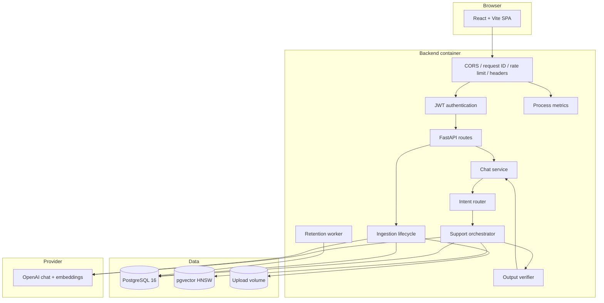
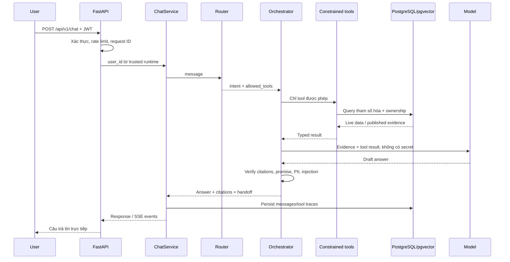
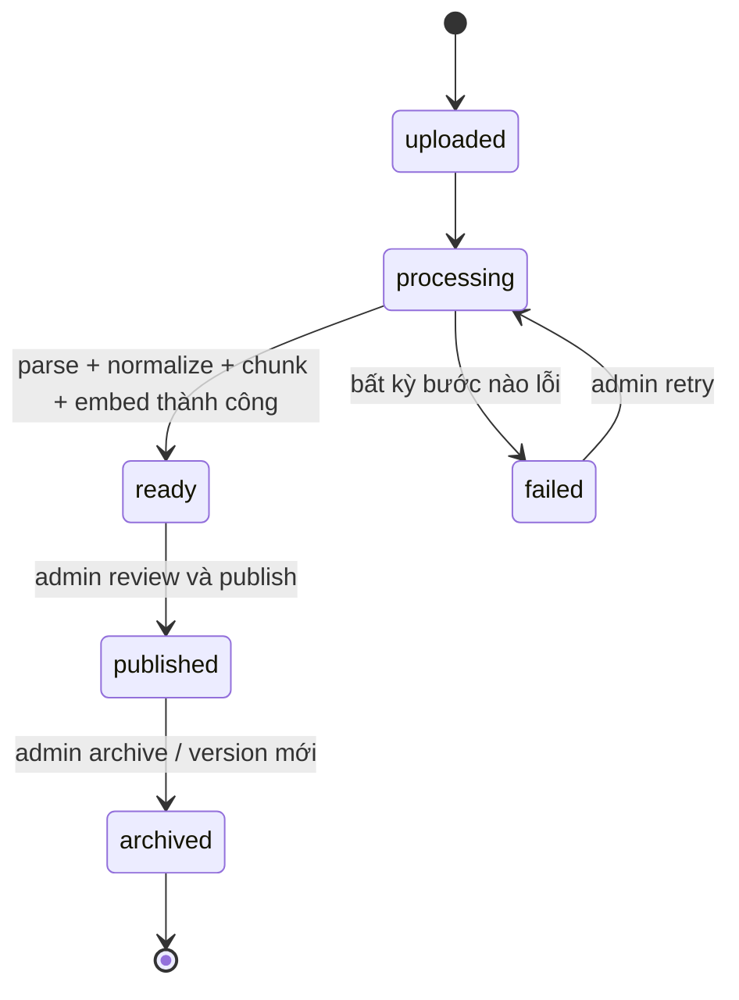
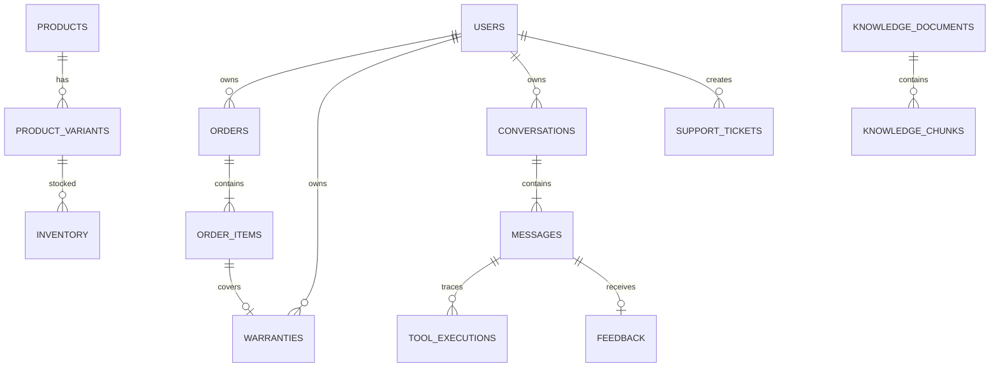

# Kiến trúc hệ thống

## Mục tiêu thiết kế

Hệ thống tách ba loại quyết định:

1. Backend xác thực và cấp runtime identity.
2. Router/orchestrator quyết định workflow trong tập tool cho phép.
3. Repository thực thi query tham số hóa và luôn áp ownership ở tầng dữ liệu.

LLM chỉ tổng hợp từ kết quả tool và evidence. Nó không phải nguồn sự thật cho dữ
liệu cửa hàng, không nhận raw SQL và không được tự tạo user ID.

## Deployment view

## Luồng chat

Với lời chào và một số safe failure deterministic, model không được gọi. Với
policy, chỉ chunk của document `published`, đúng effective window và không bị
archive mới được retrieve.

## Luồng ingestion

Checksum ngăn upload trùng. Chunk và trạng thái document được ghi transactionally;
không có partial document được publish. File chỉ nhận Markdown/PDF đã kiểm tra
magic bytes, kích thước, số trang và tên file.

## Data model chính

Mọi khoá, SKU, order code, serial, thời gian và giá được giữ nguyên ở output.
Địa chỉ giao hàng chỉ lưu/render dạng masked trong dataset demo.

## Module boundaries

- `api`: HTTP contract, authentication dependency và role check.
- `services`: use case, timeout tổng, persistence workflow.
- `ai`: router, provider abstraction, RAG, tool registry, output verifier.
- `repositories`: query SQLAlchemy tham số hóa và data ownership.
- `storage`: file persistence; không chứa business rule.
- `evaluation`: deterministic release gate.

Router dùng typed deterministic decision thay cho LLM structured output ở V1.
Đây là lựa chọn security có chủ đích: intent và exact tool allowlist được quyết
định trước model; câu hỏi kết hợp như trạng thái đơn + đổi trả bắt buộc gọi cả
order repository lẫn published knowledge. LLM chỉ tổng hợp trusted context.

Database tách ba credential: migration/provision, web runtime không có DDL, và
`app_agent` read-only cho product/order/warranty/retrieval. Tool tạo ticket là
side effect duy nhất và dùng service runtime có idempotency + explicit consent.

## Quyết định scale

V1 cố ý chạy một backend replica vì metric và sliding-window limiter đang nằm
trong process. Trước khi scale ngang phải chuyển hai state này sang shared store
(Redis/Prometheus-compatible metrics), chuyển upload sang object storage và chạy
retention bằng một scheduled worker duy nhất.
